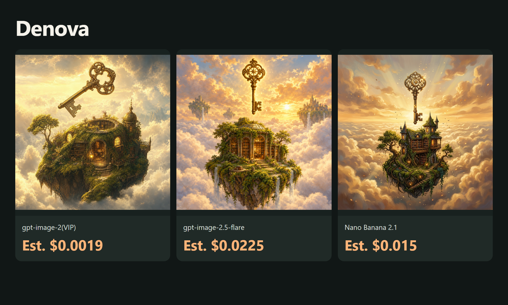

# Lower-cost Denova API asset examples

[English](README.md) · [中文](README_zh-CN.md)

Write stories and generate their illustrations.

October 16, 2026: 3 real images. Catalog estimate for these completed assets: **$0.0394**; settled charges pending.

[ToAPIs · model pricing and setup](https://go2v.toapis.com/dn16ge)

## Examples



## Models and costs in this run

| Model | Preset | Catalog estimate / output | Settled charge |
|---|---|---:|---|
| gpt-image-2(VIP) | low / 1K | $0.0019 | pending |
| gpt-image-2.5-flare | high / 1K | $0.0225 | pending |
| Nano Banana 2.1 | 1K | $0.015 | pending |

These are catalog estimates for the specified presets, not confirmed settled charges. Different models/presets do not imply equal quality. See evidence and examples for task records and originals.

## Run it

```bash
python -m pip install -r requirements.txt
python run_case.py --job jobs/gpt-image-2-vip.json
# Set TOAPIS_API_KEY privately in your local environment first.
python run_case.py --job jobs/gpt-image-2-vip.json --live
```

Dry-run by default. --live explicitly enables paid calls. Stable run_id values preserve task receipts; uncertain submissions are not automatically retried. Never commit .env, keys or private task state.

## Integrating with the original project

[Project-specific integration notes](integration/README.md) · [API contract](integration/toapis-contract.json)

[Denova upstream](https://github.com/alfredxw/denova) · SHA `b7895383d01abb311ba4bf2690dd1249a9156d26`

These are original, independent ToAPIs asset/API examples, not an official upstream release or an accepted native provider. Full upstream UI, native registration and complete workflows still need maintainer acceptance. No upstream source is redistributed.
