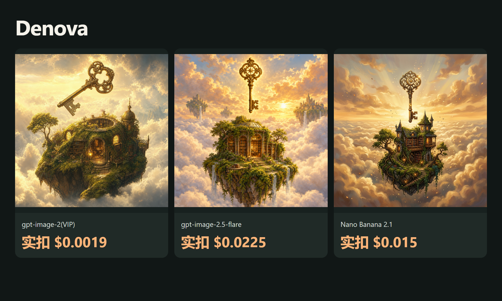

# 更低成本的 Denova API素材方案

[English](README.md) · [中文](README_zh-CN.md)

写小说、做互动故事，顺手生成配图。

2026-10-16：3张真实图片；本批成功素材实扣 **$0.0394（7.88积分）**，已按后台导出逐任务核对。

[ToAPIs · 对应模型价格与接入](https://go2v.toapis.com/dn16gc)

## 案例



## 本次模型与花费

| Model | Preset | Catalog estimate / output | Settled charge |
|---|---|---:|---|
| gpt-image-2(VIP) | low / 1K | $0.0019 | $0.0019 |
| gpt-image-2.5-flare | high / 1K | $0.0225 | $0.0225 |
| Nano Banana 2.1 | 1K | $0.015 | $0.015 |

对应配置的价表与本次实扣一致；实扣来自后台导出，1积分=$0.005。不同模型/画质不表示同等质量。逐任务记录和原始文件见evidence与examples。

## 怎么运行

```bash
python -m pip install -r requirements.txt
python run_case.py --job jobs/gpt-image-2-vip.json
# Set TOAPIS_API_KEY privately in your local environment first.
python run_case.py --job jobs/gpt-image-2-vip.json --live
```

默认只演练、不扣费。实际执行必须显式加--live；同一run_id保留任务记录，未知提交不自动重发。不要提交.env、Key或私有任务状态。

## 接入原项目

[项目对应接入说明](integration/README_zh-CN.md) · [API contract](integration/toapis-contract.json)

[Denova upstream](https://github.com/alfredxw/denova) · SHA `b7895383d01abb311ba4bf2690dd1249a9156d26`

这是ToAPIs原创、独立的素材/API示例，不是原项目官方版本或已验收原生Provider。完整上游UI、原生注册和全流程仍需维护者验收；公开包不包含上游源码。
